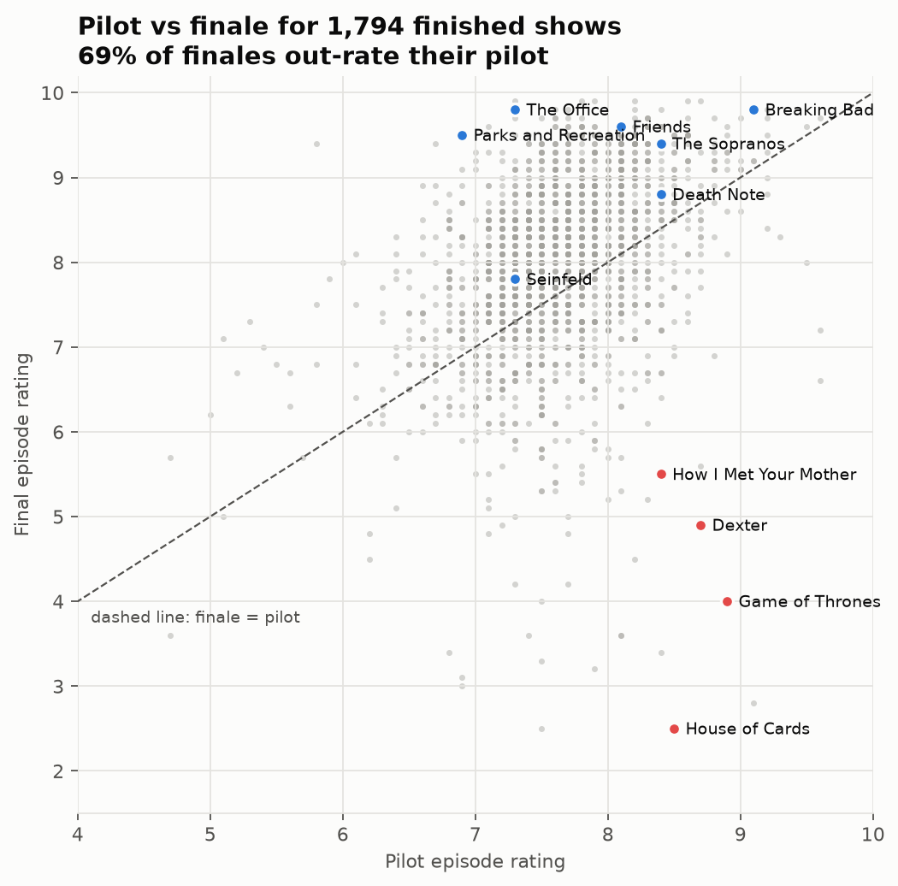
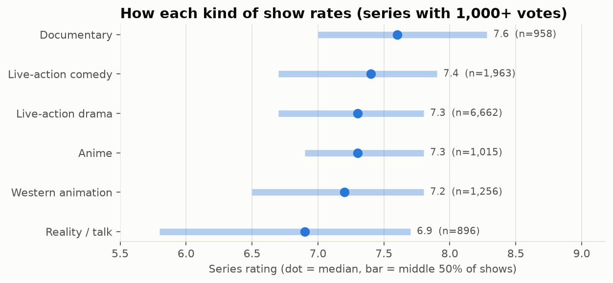
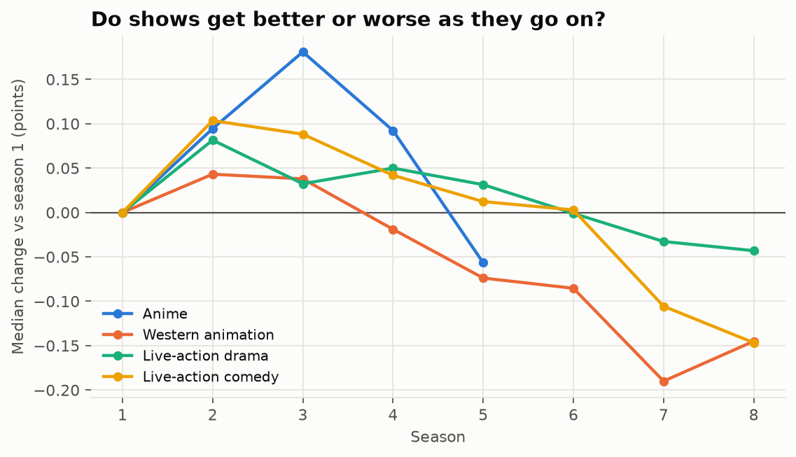
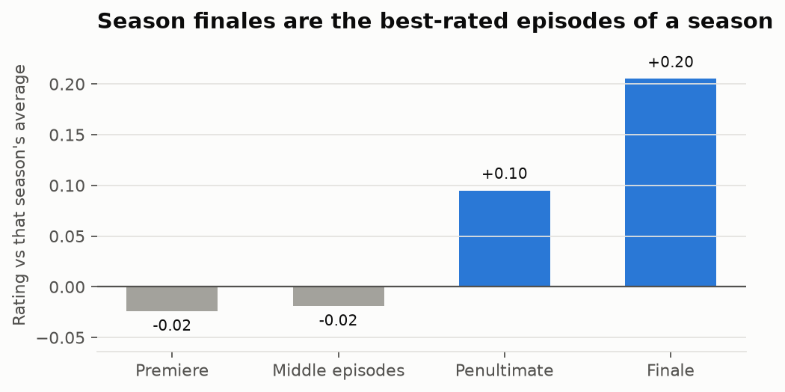
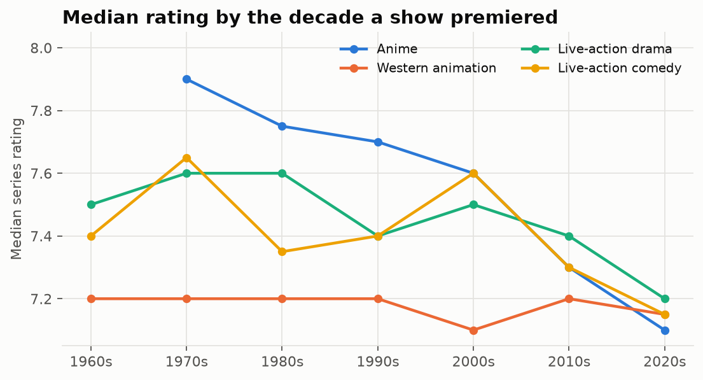
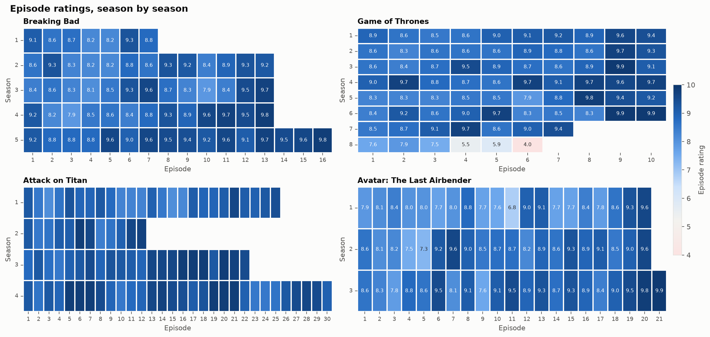
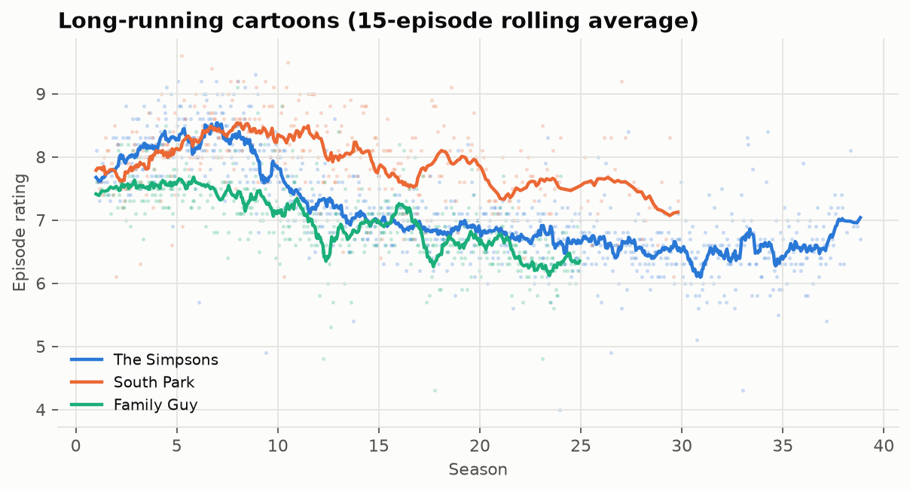

# IMDb TV Ratings Analysis

What makes a TV show rate well on IMDb? An exploratory analysis of **142,000 rated TV series and
877,000 rated episodes** from the official IMDb datasets, looking at categories (anime vs western
animation vs live-action), how shows change season by season, pilots vs finales, and episode-level
deep dives.

**→ [Read the full notebook](notebooks/tv_ratings_analysis.ipynb)**



## Key findings

| | Finding |
|---|---|
| 🎬 **Finales** | **69% of finales out-rate their pilot**, and the typical finale beats its show's average by ~0.3 points. Fans who stay to the end are generous. |
| 💥 **Worst landings** | *House of Cards* (average 7.95 → finale 2.5), *Game of Thrones* (8.74 → 4.0), *Dexter* (8.45 → 4.9), *How I Met Your Mother* (8.0 → 5.5) |
| 🏆 **Best landings** | *Naruto: Shippuden*, *The Office* (finale 9.8), *The Big Bang Theory*, *The Good Place*, *Parks and Recreation*. Sitcoms dominate. |
| 📈 **Season arcs** | Most shows improve in seasons 2-3. Anime climbs the most (+0.18 by S3); western animation is the first to fade. 57% of shows peak in a middle season. |
| 📺 **Inside a season** | Season finales beat their season's average by **+0.20**, penultimate episodes by +0.10. Premieres sit slightly below average. |
| 🎌 **Anime vs cartoons** | Anime's median (7.3) edges western animation (7.2), and its lower quartile is much higher (6.9 vs 6.5). 1970s-90s anime is the highest-rated group of any decade. |

## Charts

| | |
|---|---|
|  |  |
|  |  |





## How it works

1. **[`src/prepare.py`](src/prepare.py)** downloads `title.basics`, `title.episode` and `title.ratings`
   (~300 MB compressed) and processes them in chunks into two Parquet tables:
   - `series.parquet`: one row per TV series / mini-series, with rating, votes, genres, category, seasons
   - `episodes.parquet`: one row per rated episode with season/episode numbers
2. **Classifying anime.** IMDb has no anime genre; *Attack on Titan* and *The Simpsons* are both just
   "Animation". I first tried a heuristic using Japanese alternate titles from `title.akas`, but it
   mislabelled *Arcane* and *Love, Death & Robots* and missed *Jujutsu Kaisen*. The final version queries
   **Wikidata** (SPARQL) for every item that is an anime series and has an IMDb ID, and caches the 7,400
   IDs in [`data/reference/anime_imdb_ids.csv`](data/reference/anime_imdb_ids.csv).
3. **[`src/analysis.py`](src/analysis.py)** holds the reusable table/chart functions, and the
   [notebook](notebooks/tv_ratings_analysis.ipynb) tells the story.

### Methodology notes
- Series-level comparisons only include shows with **1,000+ votes**; season and episode analyses use
  **5,000+**; pilot-vs-finale uses finished series with **10,000+ votes and 10+ rated episodes**.
- Season ratings are the mean of that season's episode ratings, compared to the same show's season 1,
  so a great show and an average show are on the same scale.
- Episode position compares each episode with **its own season's average**.

## Run it

```bash
git clone https://github.com/kammy04/imdb-tv-ratings-analysis.git
cd imdb-tv-ratings-analysis
pip install -r requirements.txt
python src/prepare.py                 # ~2 min, downloads IMDb data on first run
jupyter notebook notebooks/tv_ratings_analysis.ipynb
```

## Future work
- **Self-selected ratings**: these are "how fans rate", not "how good it is". Survivorship bias shows up
  in the decade chart and in finale ratings.
- **Studio comparisons.** The IMDb datasets don't include production companies, so studio trends
  (e.g. MAPPA vs Wit Studio vs Toei, or HBO vs Netflix) aren't covered yet. The plan is to join TMDB's
  API (`production_companies`) on IMDb ID.
- Weighting by `numVotes` would reduce noise from thinly rated episodes.

**Tech:** Python · pandas · PyArrow/Parquet · matplotlib · seaborn · Jupyter · Wikidata SPARQL

*Data: [IMDb Non-Commercial Datasets](https://developer.imdb.com/non-commercial-datasets/), used for
personal, non-commercial analysis; raw files are not redistributed. Anime IDs from
[Wikidata](https://www.wikidata.org/) (CC0).*
